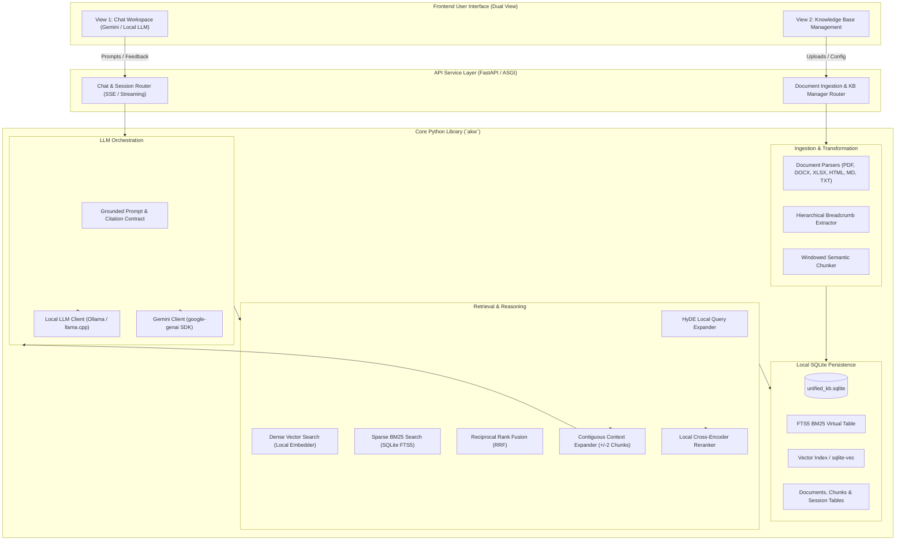

# System Architecture Specification

## 1. Executive Summary

**AI Knowledge Wrapper (`akw`)** is a modular, production-ready Python library and application framework that bridges local personal/enterprise knowledge bases with Google Gemini and local Large Language Models (LLMs).

The system addresses the fundamental challenges of modern Retrieval-Augmented Generation (RAG):
1. **Local-First Privacy & Control**: All document parsing, embeddings, vector indexing, full-text search, and hypothetical query expansions (HyDE) can execute entirely locally on user hardware.
2. **Structural Integrity & Breadcrumbing**: Chunks do not lose their semantic origin; they retain hierarchical paths (`Doc > Section > Subheading > Page/Sheet`).
3. **Surrounding Context Preservation (+/-2 Chunks)**: Rather than isolating fragments, retrieval expands each hit by pulling contiguous neighbor chunks ($\pm 2$), unifying fractured sentences, code blocks, and context windows.
4. **Hybrid Retrieval with HyDE & Cross-Encoder Reranking**: Combines SQLite FTS5 (BM25) with local dense vector search, guided by local LLM-generated Hypothetical Document Embeddings (HyDE) and refined by local cross-encoder reranking.
5. **Dual-View User Experience**: A clean interface featuring a grounded Chat Workspace and an interactive Knowledge Base Management Station.

---

## 2. High-Level Architecture Diagram



---

## 3. Core Design Principles

### 3.1. Single-File, Self-Contained Persistence (SQLite)
- All documents, extracted chunks, metadata, BM25 indices, and dense vector representations reside within a local SQLite database file (`knowledge_base.db` or `sqlite-vec`).
- Zero external vector database servers required (no Docker containers or cloud databases necessary to run locally).
- ACID-compliant transaction safety ensures robust handling of document uploads, updates, and deletes.

### 3.2. Breadcrumb-Enriched Chunks
Every chunk contains structural breadcrumb metadata:
$$\text{Breadcrumb} = \text{File Name} \rightarrow \text{Document Title} \rightarrow \text{Heading Level 1} \rightarrow \text{Heading Level 2} \rightarrow \text{Page/Sheet/Slide}$$
This ensures that when an embedding is generated or when a chunk is passed into LLM prompt context, the model knows exactly where the passage originated within the document hierarchy.

### 3.3. Contiguous Window Expansion ($\pm 2$ Neighbors)
- Real-world documents contain concepts that span across chunk boundaries (tables, multi-paragraph arguments, legal clauses).
- Ingested chunks maintain an explicit zero-indexed sequence number (`chunk_index`) per document.
- When chunk $k$ is selected as a high-relevance hit, the context assembler fetches chunks $\{k-2, k-1, k, k+1, k+2\}$, merges contiguous blocks, and deduplicates overlaps across multiple hits.

### 3.4. Multi-Stage Hybrid Retrieval Pipeline
1. **Query Formulation**: User query $Q$ is received.
2. **HyDE Expansion**: A local LLM generates a hypothetical excerpt or answer $H(Q)$.
3. **Dual Search**:
   - **Dense Retrieval**: $\text{Embed}(H(Q))$ and $\text{Embed}(Q)$ are queried against local vector storage.
   - **Sparse Retrieval**: $Q$ is queried against SQLite FTS5 with Okapi BM25 ranking.
4. **Reciprocal Rank Fusion (RRF)**: Merges sparse and dense ranked candidate lists.
5. **Cross-Encoder Reranking**: A lightweight local cross-encoder evaluates $[Q, \text{Candidate}]$ pairs to compute final calibrated relevance scores.
6. **Window Expansion**: Contiguous $\pm 2$ chunks are loaded from SQLite.
7. **Prompt Assembly & Grounding**: Context is formatted with strict citation identifiers (`[REF-1]`, `[REF-2]`), preventing hallucinations.

---

## 4. Component Boundaries & Packaging

The codebase is organized into four clean layers:

```
AI_knowledge_wrapper/
├── docs/                             # Comprehensive Architecture & System Specifications
├── src/
│   └── akw/                          # Core Python Library Package
│       ├── __init__.py               # Top-level library API exports
│       ├── config.py                 # Configuration models (Pydantic Settings)
│       ├── core/                     # Data schemas, exceptions, domain interfaces
│       ├── parsers/                  # Format-specific document extractors
│       ├── chunking/                 # Breadcrumb generator & semantic chunkers
│       ├── storage/                  # SQLite schema, FTS5 engine, vector backend
│       ├── embeddings/               # Local embedding model adapters (SentenceTransformers)
│       ├── retrieval/                # HyDE, hybrid search, RRF, reranker, window expander
│       ├── llm/                      # Gemini SDK wrapper & local LLM providers
│       └── sessions/                 # Conversation management, RAG session wrapper
├── server/                           # FastAPI Application Service
│   ├── app.py                        # FastAPI entrypoint & middleware
│   ├── routers/                      # API endpoints (chat, documents, models, settings)
│   └── dependencies.py               # Dependency injection for library singletons
├── web/                              # Dual-View Web Interface
│   ├── package.json                  # Modern frontend build setup (Vite + React / Tailwind)
│   ├── src/
│   │   ├── views/
│   │   │   ├── ChatView/             # View 1: Grounded chat with references
│   │   │   └── KnowledgeView/        # View 2: Knowledge Base management & document inspector
│   │   └── components/               # Shared UI widgets (source drawer, citation pills)
└── tests/                            # Unit, integration, and evaluation suites
```

---

## 5. Security, Local Sovereignty & Data Privacy

1. **Local-Only Processing Available**: With local embeddings (`sentence-transformers`), local HyDE (`Ollama`), and local LLM chat, no data ever leaves the user's workstation.
2. **Cloud Augmentation with Gemini**: When configured for Google Gemini, only retrieved contextual snippets necessary to answer the specific query are transmitted over TLS to the Gemini API, governed by Google Cloud / Gemini API enterprise security guidelines.
3. **No Hidden Telemetry**: The library operates without external telemetry or data phoning.

