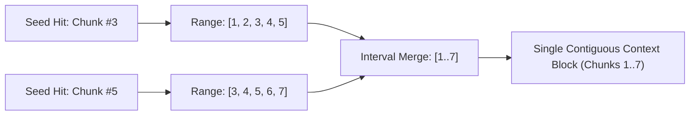

# Ingestion, Chunking & Storage Specification

## 1. Overview

Effective RAG relies on high-fidelity document ingestion and intelligent representation. This specification defines:
1. **Multi-Format Parsers**: Best-in-class Python parsing libraries for PDF, DOCX, XLSX/CSV, HTML, Markdown, and plain text.
2. **Document Breadcrumbing**: Extracting and preserving hierarchical ancestry for every text segment.
3. **Consistent Semantic Chunking**: Configurable sliding-window chunking that respects sentence and paragraph boundaries.
4. **SQLite Unified Storage Schema**: Storing metadata, raw text, FTS5 full-text indexes, and dense vectors in a single ACID-compliant database.
5. **Contiguous Neighbor Context ($\pm 2$ Chunks)**: Merging contiguous chunks to eliminate retrieval fragmentation.

---

## 2. Document Ingestion & Parsers

The ingestion pipeline employs a factory pattern with specialized parsers chosen for parsing accuracy, table support, and metadata extraction.

| Document Type | Primary Library | Extraction Capabilities |
| :--- | :--- | :--- |
| **PowerPoint** (`.pptx`, `.ppt`) | `python-pptx` + `VisionEngine` | Slide titles, bullet hierarchy, tables to markdown, presenter notes, and visual diagram/figure descriptions. |
| **PDF** (`.pdf`) | `pymupdf` (fitz) + `VisionEngine` | Fast text extraction, page numbers, heading font-size heuristic detection, embedded image extraction, TOC hierarchy. |
| **DOCX** (`.docx`) | `python-docx` | Native paragraph styles (`Heading 1`, `Heading 2`, `Normal`), table rows/cells, document properties. |
| **Spreadsheets** (`.xlsx`, `.xls`, `.csv`) | `openpyxl`, `pandas` | Sheet names, column headers, structured row-to-text serializations (e.g. Markdown tables or record key-values). |
| **HTML** (`.html`, `.htm`) | `beautifulsoup4` + `html5lib` / `lxml` | DOM heading hierarchy (`<h1>`-`<h6>`), semantic `<article>`, `<section>`, `<nav>` exclusion, table conversion. |
| **Markdown** (`.md`, `.markdown`) | `markdown-it-py` / custom AST | Header tokens (`#`, `##`, `###`), fenced code blocks, callouts, list items. |
| **Plain Text / Code** (`.txt`, `.py`, `.json`, `.yaml`) | Built-in Python I/O | Line numbers, indentation-aware blocks, structured JSON/YAML keys. |

### 2.1. Ingestion Flow & Duplicate Detection
1. **Content Hash Check**: SHA-256 hash of the incoming file is computed.
2. **Idempotency**: If the file hash exists in SQLite with unchanged metadata, the ingestion step immediately returns the existing document record, avoiding redundant compute.
3. **Parse Tree Generation**: The document parser emits an intermediate representation:
   ```python
   class ParsedBlock(BaseModel):
       content: str
       breadcrumb: List[str]  # e.g. ["User Manual", "Chapter 3: Configuration", "Database Settings"]
       page_number: Optional[int] = None
       sheet_name: Optional[str] = None
       block_type: str        # "paragraph", "table", "header", "code"
   ```

### 2.2. Graphical Asset Extraction, Storage & Vision Ingestion
For presentations (`.pptx`), Word documents (`.docx`), and technical documents (`.pdf`), visual figures, system architecture schematics, and charts hold critical knowledge:
- **`AssetManager` (`src/akw/storage/assets.py`)**: Persists extracted image bytes to `./knowledge_assets/` (or configured `AKW_ASSETS_DIR`) using deterministic SHA-256 deduplication (`ast_{sha16}.png`). Serves assets via REST endpoint `GET /api/assets/{filename}`.
- **`PPTXParser`**: Traverses slides, captures slide titles (`Slide N: Title`), structured tables, bullet levels, and presenter notes (`notes_slide`). Embedded shapes (`MSO_SHAPE_TYPE.PICTURE` or images) exceeding decorative thresholds ($\ge 64 \times 64$ px) are saved to `AssetManager` and passed to `VisionEngine`.
- **`DocxParser`**: Traverses document paragraphs and inline drawings (`.//a:blip`), extracts embedded diagram blobs, saves them to `AssetManager`, and invokes `VisionEngine`.
- **`PDFParser`**: Extracts page-level images with PyMuPDF (`doc.extract_image(xref)`). Images $\ge 100 \times 100$ px are saved to `AssetManager` and sent to `VisionEngine`.
- **`VisionEngine`**: Multimodal inference via:
  1. **LM Studio** (`/v1/chat/completions` with base64 `image_url` using `qwen/qwen3-vl-8b`).
  2. **Google Gemini** (`models.generate_content` using `gemini-3.8-flash`).
  3. **Ollama** (`/api/generate` with base64 image strings).
- **Chunk Representation**: Emits structured blocks of type `BlockType.FIGURE`:
  ```markdown
  

  **[Slide 3 Visual Figure / Diagram Description]:**
  A distributed three-tier architecture diagram showing React frontend communicating with FastAPI...
  ```
- **Chunk Isolation & Metadata**: The semantic chunker flushes surrounding text and isolates figures into focused chunks with `metadata={"image_url": "...", "asset_id": "...", "is_figure": True}`. Both SQLite FTS5 BM25 and vector embeddings index the visual description, and the web UI renders the image alongside the chunk.

### 2.3. Original File Retention & User Downloads
To ensure users never lose access to their source material, the system automatically retains an exact byte-for-byte archive of every uploaded file:
- **Archive Directory**: Saved under `./knowledge_files/{doc_id}_{filename}` (configurable via `AKW_FILES_DIR`).
- **Database Linking**: The local file path is recorded in SQLite under `documents.file_path`.
- **Download Endpoint**: Served via `GET /api/kb/documents/{id}/download` with standard `Content-Disposition: attachment; filename="..."` headers.
- **UI Integration**: One-click download buttons are surfaced in the Knowledge Base inventory table and inside the Chat Workspace context inspector drawer.

---

## 3. Hierarchical Breadcrumbing Architecture

### 3.1. The Breadcrumb Problem in Standard RAG
Standard chunkers slice text into isolated 500-token blocks. When a chunk discusses `timeout = 30`, the LLM has no idea whether it applies to the HTTP client, database connection, or caching layer.

### 3.2. Breadcrumb Tracking
During document parsing, a **Breadcrumb Stack** is maintained:
- When a Level 1 Heading (`#` or `Heading 1` or `<h1>`) is encountered, the stack is cleared and initialized with the document title and the new heading.
- When a Level 2 Heading is encountered, it pushes to or replaces the second position in the stack.
- When tabular or body text is encountered, it inherits the active breadcrumb path.

### 3.3. Chunk Breadcrumb Representation
Every chunk stores:
- **`breadcrumb_path`**: A structured JSON array of strings: `["Architecture.pdf", "Section 4: Storage", "4.2 SQLite Schema"]`.
- **`breadcrumb_display`**: A human-readable delimiter string: `Architecture.pdf > Section 4: Storage > 4.2 SQLite Schema`.
- **Search Header**: During embedding and FTS indexing, the breadcrumb is prepended to the chunk text:
  ```
  [Source: Architecture.pdf > Section 4: Storage > 4.2 SQLite Schema]
  The SQLite database stores both metadata and vector embeddings...
  ```
  This ensures that BM25 keyword searches on section names and semantic vector searches both hit the chunk accurately.

---

## 4. Chunking Engine Specification

### 4.1. Configurable Parameters
- **`target_chunk_size`**: Default 500 tokens (~1,750 characters).
- **`chunk_overlap`**: Default 100 tokens (~350 characters).
- **`min_chunk_size`**: Minimum 50 tokens (avoids orphan headers).
- **`boundary_preference`**: `["\n\n", "\n", ". ", "? ", "! ", ";", " "]`.

### 4.2. Chunk Metadata Schema
Each chunk is assigned an immutable sequential index (`chunk_index` $\in [0, N-1]$) unique to its parent `document_id`.

```json
{
  "id": "chk_01h9x3k...",
  "document_id": "doc_01h9x2m...",
  "chunk_index": 4,
  "content": "The SQLite schema includes a virtual table for BM25...",
  "token_count": 412,
  "breadcrumb": "Architecture.pdf > Storage Layer > SQLite Schema",
  "page_start": 3,
  "page_end": 4,
  "created_at": "2026-11-09T17:40:00Z"
}
```

---

## 5. Unified SQLite Storage Architecture

All data resides in a single SQLite database (`~/.akw/knowledge_base.sqlite` or custom project path).

### 5.1. Relational & Virtual Table DDL

```sql
-- 1. Documents Table
CREATE TABLE IF NOT EXISTS documents (
    id TEXT PRIMARY KEY,
    filename TEXT NOT NULL,
    file_path TEXT,
    sha256_hash TEXT NOT NULL UNIQUE,
    mime_type TEXT NOT NULL,
    file_size_bytes INTEGER NOT NULL,
    total_chunks INTEGER NOT NULL DEFAULT 0,
    created_at TIMESTAMP NOT NULL DEFAULT CURRENT_TIMESTAMP,
    updated_at TIMESTAMP NOT NULL DEFAULT CURRENT_TIMESTAMP,
    metadata_json TEXT DEFAULT '{}'
);

CREATE INDEX IF NOT EXISTS idx_documents_hash ON documents(sha256_hash);

-- 2. Chunks Table
CREATE TABLE IF NOT EXISTS chunks (
    id TEXT PRIMARY KEY,
    document_id TEXT NOT NULL,
    chunk_index INTEGER NOT NULL,
    content TEXT NOT NULL,
    breadcrumb_display TEXT NOT NULL,
    breadcrumb_json TEXT NOT NULL,
    page_start INTEGER,
    page_end INTEGER,
    token_count INTEGER NOT NULL,
    metadata_json TEXT DEFAULT '{}',
    FOREIGN KEY(document_id) REFERENCES documents(id) ON DELETE CASCADE
);

CREATE UNIQUE INDEX IF NOT EXISTS idx_chunks_doc_seq 
ON chunks(document_id, chunk_index);

-- 3. SQLite FTS5 Full-Text Search Virtual Table
CREATE VIRTUAL TABLE IF NOT EXISTS chunks_fts USING fts5(
    content,
    breadcrumb_display,
    content='chunks',
    content_rowid='rowid',
    tokenize='porter unicode61'
);

-- Triggers to synchronize Chunks with FTS5 table
CREATE TRIGGER IF NOT EXISTS chunks_ai AFTER INSERT ON chunks BEGIN
  INSERT INTO chunks_fts(rowid, content, breadcrumb_display) 
  VALUES (new.rowid, new.content, new.breadcrumb_display);
END;

CREATE TRIGGER IF NOT EXISTS chunks_ad AFTER DELETE ON chunks BEGIN
  INSERT INTO chunks_fts(chunks_fts, rowid, content, breadcrumb_display) 
  VALUES('delete', old.rowid, old.content, old.breadcrumb_display);
END;

CREATE TRIGGER IF NOT EXISTS chunks_au AFTER UPDATE ON chunks BEGIN
  INSERT INTO chunks_fts(chunks_fts, rowid, content, breadcrumb_display) 
  VALUES('delete', old.rowid, old.content, old.breadcrumb_display);
  INSERT INTO chunks_fts(rowid, content, breadcrumb_display) 
  VALUES (new.rowid, new.content, new.breadcrumb_display);
END;

-- 4. Vectors Storage
-- Supports sqlite-vec extension or fallback pure SQLite BLOB table with cosine math
CREATE TABLE IF NOT EXISTS chunk_embeddings (
    chunk_id TEXT PRIMARY KEY,
    model_name TEXT NOT NULL,
    dimensions INTEGER NOT NULL,
    embedding BLOB NOT NULL,
    FOREIGN KEY(chunk_id) REFERENCES chunks(id) ON DELETE CASCADE
);

-- 5. Chat History & Session State
CREATE TABLE IF NOT EXISTS chat_sessions (
    id TEXT PRIMARY KEY,
    title TEXT NOT NULL,
    model_provider TEXT NOT NULL, -- 'gemini' | 'ollama' | 'local'
    model_name TEXT NOT NULL,
    system_instruction TEXT,
    created_at TIMESTAMP NOT NULL DEFAULT CURRENT_TIMESTAMP,
    updated_at TIMESTAMP NOT NULL DEFAULT CURRENT_TIMESTAMP
);

CREATE TABLE IF NOT EXISTS chat_messages (
    id TEXT PRIMARY KEY,
    session_id TEXT NOT NULL,
    role TEXT NOT NULL,           -- 'user' | 'model' | 'system'
    content TEXT NOT NULL,
    retrieved_context_json TEXT,  -- Contains chunk references, breadcrumbs, scores
    created_at TIMESTAMP NOT NULL DEFAULT CURRENT_TIMESTAMP,
    FOREIGN KEY(session_id) REFERENCES chat_sessions(id) ON DELETE CASCADE
);
```

---

## 6. Neighbor Context Expansion ($\pm 2$ Chunks)

### 6.1. Motivation
Individual chunks often start or end abruptly mid-argument, breaking code blocks or separating a table from its descriptive context. By pulling contiguous neighbor chunks ($\pm 2$), the retrieval pipeline restores complete paragraphs and documents the entire thought.

### 6.2. Multi-Hit Range Merging Algorithm

When search and reranking identify top-$K$ seed chunks, neighboring chunks are gathered and merged:



#### Algorithm Steps:
1. For each seed chunk $(D_i, C_k)$ from document $D_i$ with index $C_k$, compute interval $[k-2, k+2]$.
2. Group all intervals by $D_i$.
3. For each document, merge overlapping or adjacent intervals (e.g., $[1, 5]$ and $[4, 8] \rightarrow [1, 8]$).
4. Fetch all chunks in the merged intervals via a single SQL query:
   ```sql
   SELECT id, chunk_index, content, breadcrumb_display, page_start, page_end
   FROM chunks
   WHERE document_id = :doc_id 
     AND chunk_index BETWEEN :start_idx AND :end_idx
   ORDER BY chunk_index ASC;
   ```
5. Concatenate contiguous chunks with a subtle separator, preserving the primary breadcrumb and tagging the seed chunk so the prompt highlights the core match while offering surrounding context.

