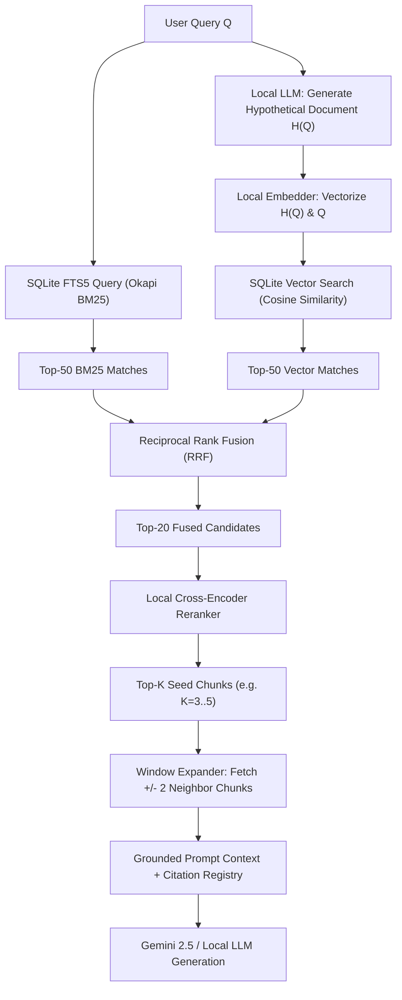

# Retrieval, HyDE & RAG Pipeline Specification

## 1. Pipeline Overview

The retrieval engine employs a modern multi-stage retrieval architecture designed to maximize precision and recall while running locally:



---

## 2. Hypothetical Document Embeddings (HyDE)

### 2.1. The Semantic Gap Problem
User queries are frequently short, interrogative, or underspecified:
> *"How do I fix the database timeout error during bulk inserts?"*

The raw query embedding looks like a question, whereas target document passages look like declarative technical explanations:
> *"To prevent connection timeout exceptions when executing batch transactions, configure `pool_timeout=60` and `max_overflow=20`..."*

### 2.2. HyDE Architecture
HyDE bridges this gap by prompting a **local LLM** (e.g., via Ollama running `gemma2:2b`, `llama3.2:3b`, or `qwen2.5:3b`) to draft a concise hypothetical passage before querying the vector store:

```
[System Prompt for HyDE]
You are a technical knowledge assistant. Write a short, authoritative, factual passage that directly answers the user query. Do not provide disclaimers or commentary. Write only the simulated factual content that would be found in a relevant documentation file.

[Query]: {user_query}
[Hypothetical Passage]:
```

### 2.3. Dual Embedding Strategy
1. The local embedder vectorizes both the original user query $v_Q = \text{Embed}(Q)$ and the hypothetical document $v_H = \text{Embed}(H(Q))$.
2. The blended vector:
   $$v_{\text{search}} = \alpha \cdot v_H + (1 - \alpha) \cdot v_Q \quad (\text{default } \alpha = 0.7)$$
3. If the local LLM is disabled or unavailable, the system smoothly falls back to $v_{\text{search}} = v_Q$.

---

## 3. Local Embedding Models

The library provides plug-and-play support for user-specified local embedding models via `sentence-transformers` and Ollama:

| Model | Dimensions | Strengths |
| :--- | :--- | :--- |
| `BAAI/bge-small-en-v1.5` *(Default)* | 384 | Exceptionally fast CPU inference (~30ms), top MTEB retrieval performance. |
| `sentence-transformers/all-MiniLM-L6-v2` | 384 | Ultra-lightweight (80MB), runs efficiently on any CPU. |
| `nomic-ai/nomic-embed-text-v1.5` | 768 | 8k context window, Matryoshka representation learning support. |
| `BAAI/bge-base-en-v1.5` | 768 | Higher semantic accuracy for complex corporate/technical corpora. |
| Local Ollama Embeddings | Configurable | Enables sharing model weights with an existing Ollama daemon. |

---

## 4. Sparse Search via SQLite FTS5 (BM25)

Dense vectors excel at semantic concepts but can miss exact alphanumeric strings, serial numbers, error codes, function signatures, and SKU numbers. SQLite's native FTS5 extension provides high-performance Okapi BM25 scoring:

```sql
SELECT 
    c.id,
    c.document_id,
    c.chunk_index,
    c.content,
    c.breadcrumb_display,
    bm25(chunks_fts, 2.0, 1.0) AS bm25_score
FROM chunks_fts
JOIN chunks c ON chunks_fts.rowid = c.rowid
WHERE chunks_fts MATCH :sanitized_query
ORDER BY bm25_score ASC
LIMIT 50;
```

---

## 5. Reciprocal Rank Fusion (RRF) & Cross-Encoder Reranking

### 5.1. Reciprocal Rank Fusion (RRF)
To combine the disparate scoring scales of BM25 and cosine distance, RRF calculates a combined score based on ranked positions:

$$RRF(d) = \frac{1}{60 + \text{rank}_{\text{dense}}(d)} + \frac{1}{60 + \text{rank}_{\text{bm25}}(d)}$$

Where candidates appearing in both lists receive a strong compounding boost.

### 5.2. Local Cross-Encoder Reranking
While bi-encoders generate separate embeddings for queries and documents, a **cross-encoder** feeds both simultaneously into transformer self-attention layers:
$$\text{Score} = \text{CrossEncoder}([Q, \text{Chunk Content}])$$

Supported lightweight local rerankers:
- **`flashrank`**: Ultra-fast, zero-dependency pure Python/ONNX reranker running `ms-marco-TinyBERT-L-2-v2` or `bge-reranker-large` (~10ms latency).
- **`cross-encoder/ms-marco-MiniLM-L-6-v2`**: High accuracy, standard HuggingFace cross-encoder.

The top-20 RRF candidates are scored by the cross-encoder, and the top $K$ (default $K=3$) become **seed chunks**.

---

## 6. Neighbor Window Expansion ($\pm 2$) & Context Assembly

### 6.1. Boundary Expansion
For each seed chunk $C_k$, the engine fetches chunks from $k-2$ to $k+2$.

```
[Chunk k-2] Leading context / paragraph intro...
[Chunk k-1] Specific conditions and prerequisite parameters...
[Chunk k]   >>> SEED HIT: Core code example or procedure <<<
[Chunk k+1] Error handling details and edge case notes...
[Chunk k+2] Follow-up actions and related API references...
```

### 6.2. Overlap Deduplication
If seed chunk 3 and seed chunk 5 are selected:
- Interval 1: $[1, 2, 3, 4, 5]$
- Interval 2: $[3, 4, 5, 6, 7]$
- Merged interval: $[1, 2, 3, 4, 5, 6, 7]$

The expanded window is presented to the LLM as a single coherent document block, eliminating redundant headers and fragmented sentences.

---

## 7. Grounded LLM Prompt Contract & Citations

The assembled context is delivered to Gemini (or local LLM) with an unambiguous citation protocol:

```markdown
You are a helpful and meticulous knowledge assistant answering questions based strictly on the user's local documents.

### CONSTRAINTS
1. Use ONLY the provided Context to answer the question.
2. If the context does not contain enough information, state clearly that the answer is not found in the local knowledge base. Do NOT fabricate information.
3. Every factual claim, statistic, or step MUST be cited using the reference tag: [REF-X].
4. At the bottom of your response, provide a 'References' section matching the tags you used.

### RETRIEVED CONTEXT:

---
[REF-1]
Document: deployment_guide.docx
Breadcrumb: Deployment Guide > Production Setup > SSL Certificates
Page/Location: Section 3.1
Content:
... expanded text (+/- 2 chunks) ...
---

[REF-2]
Document: api_reference.pdf
Breadcrumb: API Reference > Authentication > JWT Refresh
Page/Location: Page 14
Content:
... expanded text (+/- 2 chunks) ...
---

### USER QUERY:
{query}
```

